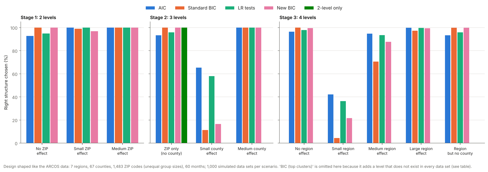
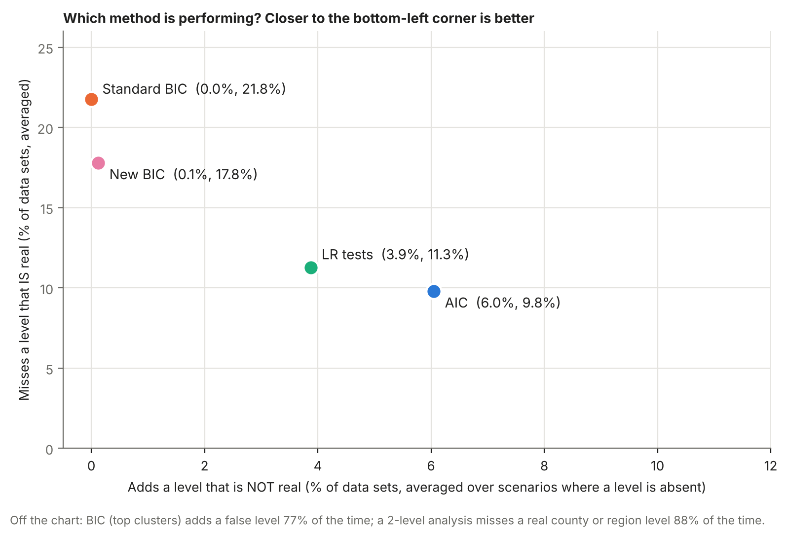
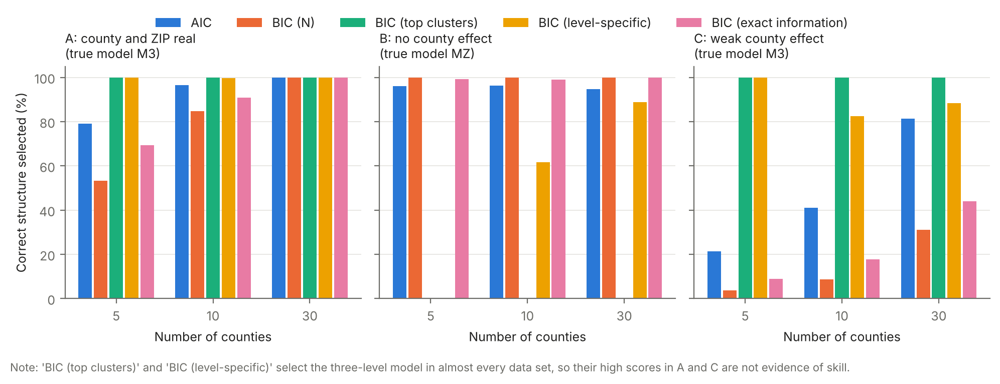
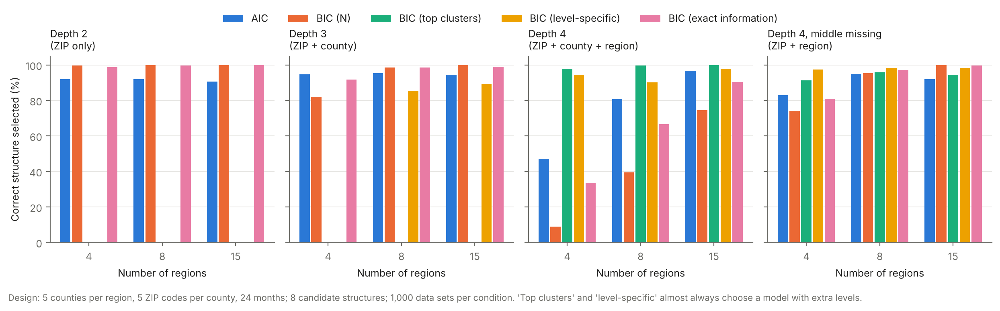
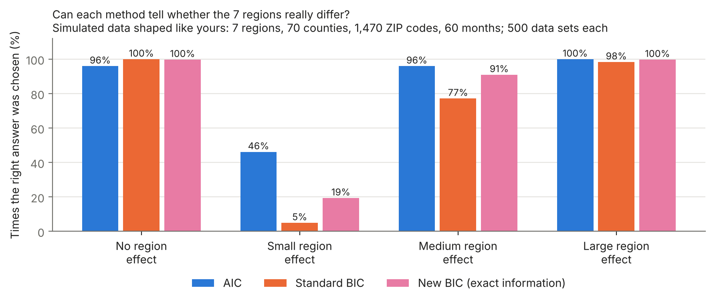
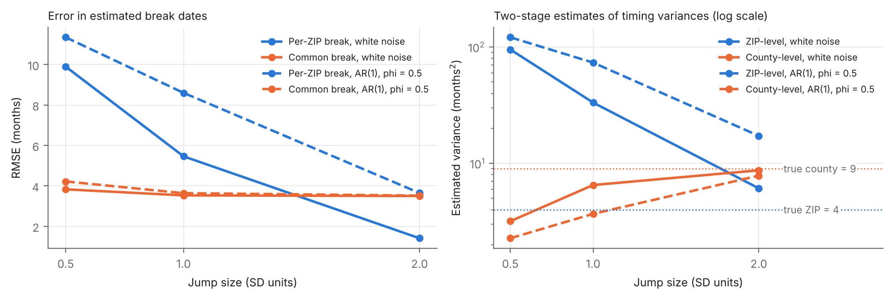

# Pilot simulations

Simulations for the two thesis directions. They are **pilots**: balanced designs, intercept-only means and modest numbers of replications. They show what the full simulation chapters would study and what the first results look like. They are not final results.

Run with Python 3 (numpy, scipy, matplotlib):

```
python3 d1_bic_levels.py      # Direction 1, three levels -> results/d1_selection.csv
python3 d1_depth_4level.py    # Direction 1, depths 2-4   -> results/d1_depth_4level.csv
python3 d1_your_design.py     # Direction 1, real-data shape -> results/d1_your_design.csv
python3 plot_your_design.py
python3 d3_change_points.py   # Direction 2 -> results/d3_change_points.csv
python3 make_figures.py       # figures/*.png
```

## Start here: main results (staged study)

`staged_study.py` follows the thesis plan step by step on a design shaped like the ARCOS data: **7 regions, 67 counties (unequal numbers per region), 1,483 ZIP codes (unequal numbers per county), 60 months**, with 1,000 simulated data sets per scenario. Every data set is fitted under every possible level structure by exact maximum likelihood (checked against the closed forms of the balanced case), and each method picks one.

- **Stage 1: 2 levels** (months within ZIP): the setting where a BIC already exists.
- **Stage 2: 3 levels** (months within ZIP within county).
- **Stage 3: 4 levels** (months within ZIP within county within region).

Methods: AIC; standard BIC (k log N, the R default); BIC with the number of top-level clusters (SAS style); backward likelihood-ratio tests with the boundary correction at 5%; the new exact-information BIC; and "2-level analysis only" (ignore county and region).



**Percentage of data sets in which the right structure was chosen**

| Stage | True world | AIC | Standard BIC | LR tests | New BIC | BIC (top clusters) | 2-level only |
|---|---|---|---|---|---|---|---|
| Stage 1: 2 levels | No ZIP effect | 92.7 | 100.0 | 94.9 | 100.0 | 0.0 | – |
|  | Small ZIP effect | 100.0 | 99.0 | 100.0 | 96.9 | 100.0 | – |
|  | Medium ZIP effect | 100.0 | 100.0 | 100.0 | 100.0 | 100.0 | – |
| Stage 2: 3 levels | ZIP only (no county) | 93.3 | 100.0 | 95.9 | 100.0 | 0.0 | 100.0 |
|  | Small county effect | 65.4 | 11.3 | 58.0 | 16.6 | 100.0 | 0.0 |
|  | Medium county effect | 100.0 | 100.0 | 100.0 | 100.0 | 100.0 | 0.0 |
| Stage 3: 4 levels | No region effect | 96.4 | 100.0 | 97.8 | 99.5 | 0.0 | 0.0 |
|  | Small region effect | 42.1 | 4.4 | 36.3 | 21.7 | 100.0 | 0.0 |
|  | Medium region effect | 94.8 | 70.6 | 93.4 | 87.6 | 100.0 | 0.0 |
|  | Large region effect | 99.8 | 97.3 | 99.7 | 99.4 | 100.0 | 0.0 |
|  | Region but no county | 93.3 | 99.8 | 95.8 | 99.8 | 93.2 | 0.0 |



**Overall performance** (adds a false level: averaged over scenarios where some level is absent; misses a real level: averaged over scenarios where some level is real)

| Method | Average % correct | Adds a false level (%) | Misses a real level (%) |
|---|---|---|---|
| AIC | 88.9 | 6.0 | 9.8 |
| Standard BIC (N) | 80.2 | 0.0 | 21.8 |
| Likelihood ratio tests | 88.3 | 3.9 | 11.3 |
| New BIC (exact information) | 83.8 | 0.1 | 17.8 |
| BIC (top clusters) | 72.1 | 76.7 | 0.0 |
| 2-level analysis only | 12.5 | 0.0 | 87.5 |

**What the results say**

1. **Two levels are easy with 1,483 ZIP codes.** Every sensible method gets almost every data set right. This matches the fact that the 2-level problem is already solved.
2. **The difficulty is at the top of the hierarchy.** With only 7 regions (or a small county effect), real effects are often missed. Standard BIC finds a small region effect in only 4% of data sets and a medium one in 71%.
3. **The new BIC is a clear improvement on standard BIC** at the same, almost zero, rate of false levels: small region effect 22% vs 4%, medium region effect 88% vs 71%, small county effect 17% vs 11%.
4. **Likelihood-ratio tests and AIC find real effects most often**, but they add a level that does not exist about 4% and 6% of the time. The BICs almost never do. This is a trade-off between missing real levels and inventing false ones, not a single winner.
5. **Two approaches clearly fail.** BIC with top-level clusters adds a false level in most data sets, and a 2-level analysis cannot detect county or region effects at all.

**What this means for the thesis.** The new BIC improves on the standard BIC used by most software precisely where the ARCOS data are weakest: few units at the top level. The thesis would derive it properly, explain the trade-off with likelihood-ratio tests and AIC, and apply it to the real data. These are pilot results: intercept-only models, assumed variance sizes, 60 assumed months, and synthetic group sizes with the real totals.

Run it with: `OMP_NUM_THREADS=1 REPS=1000 python3 staged_study.py && python3 plot_staged.py`

## Earlier pilot runs

## Direction 1: selecting levels with BIC

**Design.** Months (T = 24) within ZIP codes (Z = 10 per county) within C = 5, 10 or 30 counties; 1,000 data sets per condition; residual variance 1, ZIP variance 0.5. Four candidate models are fitted by maximum likelihood: no random effects (M0), ZIP only (MZ), county only (MC), and county plus ZIP (M3). The likelihood is computed exactly from the three ANOVA strata of the balanced design; the code checks the closed-form ML fit against a numerical optimiser.

**Criteria compared.** AIC; BIC with total N; BIC with the number of top-level clusters; the leading-order level-specific BIC (proposal equation 4); and a BIC whose penalty is the exact log-determinant of the Fisher information at each model's own fit (the Laplace approximation, proposal equation 2).



**Percentage of data sets in which the true structure was selected**

| Scenario (truth) | Counties | AIC | BIC (N) | BIC (top clusters) | BIC (level-specific) | BIC (exact information) |
|---|---|---|---|---|---|---|
| A: county and ZIP real (M3) | 5 | 79.1 | 53.3 | 100.0 | 100.0 | 69.4 |
| | 10 | 96.5 | 84.7 | 100.0 | 99.6 | 90.8 |
| | 30 | 100.0 | 100.0 | 100.0 | 100.0 | 100.0 |
| B: no county effect (MZ) | 5 | 96.1 | 99.9 | 0.0 | 0.0 | 99.2 |
| | 10 | 96.2 | 99.9 | 0.0 | 61.6 | 99.1 |
| | 30 | 94.8 | 99.9 | 0.0 | 88.9 | 99.9 |
| C: weak county effect (M3, county variance 0.05) | 5 | 21.4 | 3.6 | 100.0 | 100.0 | 8.9 |
| | 10 | 41.0 | 8.7 | 100.0 | 82.6 | 17.7 |
| | 30 | 81.4 | 31.1 | 100.0 | 88.3 | 44.1 |

**What the pilot shows**

1. **BIC with total N drops real county levels when counties are few:** it finds the true structure in only 53% of data sets with 5 counties (scenario A).
2. **The leading-order level-specific penalty (equation 4) fails when a level is absent.** With fewer counties than ZIP codes per county, adding the county level moves the intercept's penalty from log(#ZIPs) down to log(#counties). The larger model then has a *smaller* penalty and is always chosen, so the criterion never detects a missing county level (0% in scenario B with 5 counties). BIC with top-level clusters fails for the same reason. Equation 4 was derived assuming every variance component is positive. **The derivation therefore has to treat the boundary case (a variance equal to zero) explicitly**, which is the central theoretical task of Direction 1.
3. **Using the exact information instead of leading-order log n terms repairs this.** That criterion keeps false county levels out (99% correct in scenario B) and finds real county levels more often than BIC with total N (69% vs 53% with 5 counties; 91% vs 85% with 10).
4. **No criterion detects a weak county effect with few counties.** This trade-off between power and false inclusion is what the full simulation chapter would map.

## Direction 1 with two, three and four levels

**Design.** Months (T = 24) within ZIP codes (5 per county) within counties (5 per region) within R = 4, 8 or 15 regions; variances: residual 1, ZIP 0.5, county 0.3, region 0.3; 1,000 data sets per condition. The true structure has depth 2 (ZIP only), 3 (ZIP + county), 4 (ZIP + county + region), or 4 with the middle level missing (ZIP + region). All 8 candidate structures are fitted by exact ML (checked against a numerical optimiser) and the same five criteria choose among them.



**Percentage of data sets in which the true structure was selected**

| True structure | Regions | AIC | BIC (N) | BIC (top clusters) | BIC (level-specific) | BIC (exact information) |
|---|---|---|---|---|---|---|
| Depth 2: ZIP only | 4 | 91.9 | 99.8 | 0.0 | 0.0 | 98.9 |
| | 8 | 92.1 | 99.9 | 0.0 | 0.0 | 99.7 |
| | 15 | 90.6 | 99.9 | 0.0 | 0.0 | 99.9 |
| Depth 3: ZIP + county | 4 | 94.7 | 82.1 | 0.0 | 0.0 | 91.7 |
| | 8 | 95.3 | 98.6 | 0.0 | 85.5 | 98.6 |
| | 15 | 94.6 | 100.0 | 0.0 | 89.3 | 99.1 |
| Depth 4: ZIP + county + region | 4 | 47.2 | 9.0 | 97.8 | 94.5 | 33.7 |
| | 8 | 80.7 | 39.4 | 99.7 | 90.2 | 66.7 |
| | 15 | 96.8 | 74.5 | 100.0 | 97.8 | 90.5 |
| Depth 4, middle missing: ZIP + region | 4 | 83.0 | 74.2 | 91.3 | 97.4 | 80.9 |
| | 8 | 95.0 | 95.3 | 95.8 | 98.2 | 97.2 |
| | 15 | 91.9 | 99.9 | 94.5 | 98.3 | 99.7 |

**What it shows**

1. **When the true model is shallow (depth 2 or 3), the leading-order penalties fail completely:** BIC with top-level clusters and the level-specific BIC add levels that do not exist (0% correct with 4 regions). Their high scores for depth 4 come from this same bias toward extra levels, not from skill.
2. **BIC with total N is reliable for shallow truths but misses a real region level when regions are few:** 9% correct with 4 regions and 39% with 8.
3. **The exact-information BIC is the only BIC that does well in every scenario with enough regions** (91-100% with 15 regions). It recovers depth 4 far more often than BIC with total N (34% vs 9% with 4 regions; 67% vs 39% with 8) while staying near 99% for shallow truths.
4. **With only 4 regions, no criterion recovers depth 4 reliably.** This is the few-top-level-units problem the thesis targets.

## Direction 1 with a design shaped like the real data

The ARCOS data have 7 regions, 67 counties and 1,483 ZIP codes. This run approximates them with a balanced design of 7 regions × 10 counties × 21 ZIP codes (70 counties, 1,470 ZIPs) and 60 months, with ZIP variance 0.5 and county variance 0.3. The region variance is 0 (no region effect), 0.05 (small), 0.3 (medium) or 1.0 (large); 500 data sets each. The question is whether each method can tell if the 7 regions really differ.



| Truth | AIC | Standard BIC (N) | New BIC (exact information) |
|---|---|---|---|
| No region effect | 96.0 | 100.0 | 99.8 |
| Small region effect | 46.2 | 5.0 | 19.4 |
| Medium region effect | 96.0 | 77.2 | 91.0 |
| Large region effect | 100.0 | 98.4 | 99.8 |

BIC with top-level clusters and the leading-order level-specific BIC chose the four-level model in every data set (0% when there is no region effect, 100% otherwise), so they are omitted from the table.

With only 7 regions, a small regional difference is almost never detected by standard BIC (5%). The exact-information BIC detects it more often (19%), and detects a medium difference 91% of the time against 77% for standard BIC, while still almost never adding a region level that does not exist.

## Direction 2: nested random change points

**Design.** C = 10 counties × Z = 10 ZIP codes, T = 48 months, one level shift per ZIP code. Break dates are nested: county shift SD 3 months and ZIP shift SD 2 months around month 24 (true timing variances 9 and 4). The jump size is 0.5, 1 or 2 noise SDs, with white-noise or AR(1) (phi = 0.5) errors; 300 data sets per condition.

The pilot does **not** fit the proposed hierarchical model. It measures the simple alternatives the model would have to beat: per-ZIP least-squares break dates, one common break date, and a two-stage estimate of the timing variances (nested ANOVA on the per-ZIP estimated dates).



| Errors | Jump (SD) | RMSE per-ZIP (months) | RMSE common break | Exact dates (%) | County timing var. (true 9) | ZIP timing var. (true 4) |
|---|---|---|---|---|---|---|
| white noise | 0.5 | 9.90 | 3.83 | 9.1 | 3.18 | 95.23 |
| | 1.0 | 5.46 | 3.53 | 26.0 | 6.51 | 33.29 |
| | 2.0 | 1.41 | 3.50 | 62.8 | 8.71 | 6.10 |
| AR(1), 0.5 | 0.5 | 11.35 | 4.22 | 6.1 | 2.27 | 121.24 |
| | 1.0 | 8.60 | 3.64 | 17.5 | 3.68 | 73.44 |
| | 2.0 | 3.65 | 3.52 | 54.3 | 7.84 | 17.24 |

**What the pilot shows**

1. **Per-ZIP estimates are reliable only for large jumps.** With a jump of 2 SDs the break-date RMSE is 1.4 months; with 0.5 SD it is almost 10 months.
2. **A common break date ignores real differences in timing.** Its error stays near 3.5 months whatever the jump size, because ZIP codes truly break at different times.
3. **The two-stage approach badly misstates the timing variances.** Estimation error in each ZIP's date is counted as real ZIP-level variation: the estimated ZIP timing variance is 95 instead of 4 for small jumps. Meanwhile the county-level variance is underestimated. Autocorrelation makes this worse.
4. **This is the gap the proposed model targets.** A hierarchical model that estimates break dates and timing variances jointly can separate estimation noise from true variation in timing and borrow strength across ZIP codes in the same county.

## Limitations of these pilots

Balanced designs only; intercept-only means; Gaussian errors; no covariates; modest replication counts; and the proposed change-point model itself is not yet fitted. The full simulation chapters would relax each of these.
